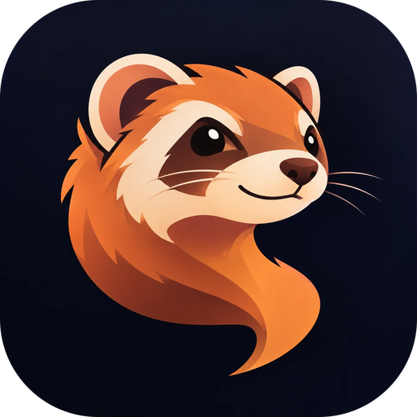

<div align="center">



# Ferret

**Stoat, with a few more tricks.**
A free desktop app for [Stoat](https://stoat.chat) for Windows and Linux. Same accounts, same servers, same people: it talks to the official Stoat servers exactly like the normal app.

> **Unofficial mod of Stoat, not affiliated with or endorsed by Stoat / Revolt Platforms Ltd.**

[**⬇ Download the latest release**](https://github.com/Sp00kii/ferret/releases/latest) · [Website](https://sp00kii.github.io/ferret/) · [Roadmap](ROADMAP.md)

</div>

## What Ferret adds

**It stays connected.** Friends show online again without pressing F5, everything resyncs after your PC sleeps or your network drops, and a dropped call rejoins itself. Desktop notifications, a taskbar unread badge and ringing calls actually reach you.

**In calls**

- Push to talk (a key or a side mouse button, even in games), a mic sensitivity noise gate, and mute / deafen shortcuts that work anywhere.
- A compact always-on-top call window, a ping and packet-loss indicator, a mic test, and your mic and speakers remembered (and followed when you unplug a headset).
- A soundboard with Ferret's clips and your own sounds. Turn anyone's soundboard down or off, just for you.
- Screen share sound choices: no sound, one app only, or everything except the call so nobody hears themselves back (Windows 11).

**Messages**

- Reply from notification pop-ups, previews for links Stoat can't preview, a time picker everyone sees in their own time zone, and favourite GIFs.
- Personas: post under another name and picture for role-play, where the server allows it.
- Private nicknames only you see, per-person ringtones and message sounds, and friend links.
- View a server as one of its roles to check what members with that role can do.

**Make it yours**

- Themes (Midnight, Cream, High contrast), any accent colour, ten app icons, and a pack of ferret-made sounds you can swap in for every alert.
- Readable fonts (Atkinson Hyperlegible, OpenDyslexic, Lexend), bigger text and zoom, reduced motion, underlined links, and round, rounded or square avatars.
- Settings backup to a single file, a Discord status that shows Ferret, and a spellcheck language picker.

Everything lives in one **Ferret** page in Settings.

## Installing

**Windows**

1. Download `FerretSetup.exe` from the [latest release](https://github.com/Sp00kii/ferret/releases/latest) and run it. On a Windows on ARM PC, use `FerretSetup-arm64.exe`.
2. **Windows SmartScreen will warn you** because the installer isn't code-signed. Click **More info → Run anyway**. Only download Ferret from this page or the website.
3. Ferret installs to `%LocalAppData%\ferret` (settings live in `%AppData%\Ferret`) and starts automatically. It checks GitHub for new versions on startup and asks before updating.

**Linux:** get the `.deb` or the `.tar.gz` from the same release. Windows is the main platform, so a few features may not be available on Linux.

Ferret installs **next to** the official Stoat app, with its own install folder, data folder and app ID, so you can keep both. You log in once in Ferret, as it keeps its own session.

## Building from source

You need [Git](https://git-scm.com/), [Node.js 24+](https://nodejs.org/) and pnpm 11 (`npm install -g pnpm@11`).

```bash
# clone with the web client + SDK submodules
git clone --recursive https://github.com/Sp00kii/ferret
cd ferret

# install the desktop app's dependencies
pnpm install

# build the modded web client into build/web (first time ~5 min)
pnpm web:build

# run Ferret in development mode (it uses its own data folder, so it never
# touches an installed Ferret)
pnpm start

# build an installer into out/make
pnpm make
```

After changing web client code, `pnpm web:build:fast` rebuilds without reinstalling packages. The Windows screen share sound helper (`native/audio-capture`) is built with `pnpm audio:build` and needs Visual Studio's C++ tools.

### How the repos fit together

| Repo | What it is |
| --- | --- |
| [`Sp00kii/ferret`](https://github.com/Sp00kii/ferret) | This repo: the Electron desktop app (fork of [stoatchat/for-desktop](https://github.com/stoatchat/for-desktop)) |
| [`Sp00kii/ferret-web`](https://github.com/Sp00kii/ferret-web) | The web client, as the `web/` submodule (fork of [stoatchat/for-web](https://github.com/stoatchat/for-web)) |
| [`Sp00kii/ferret-sdk`](https://github.com/Sp00kii/ferret-sdk) | The JS SDK, as `web/packages/stoat.js` (fork of [stoatchat/javascript-client-sdk](https://github.com/stoatchat/javascript-client-sdk)) |

The official desktop app loads `https://stoat.chat/app`. Ferret instead bundles its own build of the web client and serves it from `ferret-app://app`, while still talking to `api.stoat.chat`.

- [CHANGES.md](CHANGES.md) lists everything Ferret modifies.
- [ROADMAP.md](ROADMAP.md) lists what's planned and what Stoat users ask for.

## License

Ferret is licensed under the [GNU AGPL-3.0](LICENSE), like the Stoat projects it is based on. Original work © Revolt Platforms Ltd and the Stoat contributors; Ferret's modifications © Sp00kii.

*Unofficial mod of Stoat, not affiliated with or endorsed by Stoat / Revolt Platforms Ltd.* Ferret uses no Stoat logos or brand assets.

## Name and artwork

The code is AGPL-3.0, like the Stoat code it's built on. Ferret's own
name, logo, mascot, icons, sounds, ringtones and website are **not** part of
that licence: they're © Sp00kii, all rights reserved. See [NOTICE.md](NOTICE.md).
